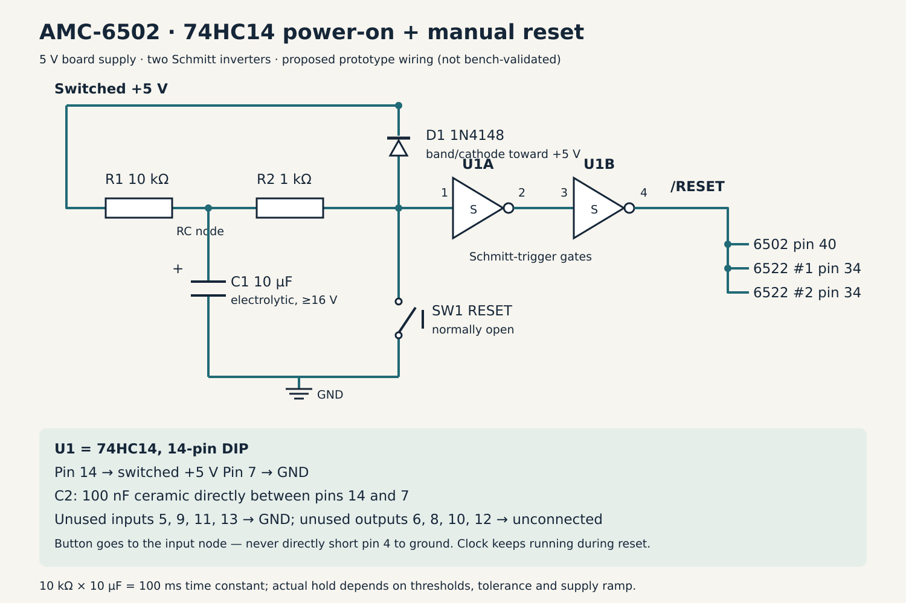

# 74HC14 power-on and manual reset

Accepted direction: use the user's existing **74HC14** with an RC delay, discharge diode and manual button. This supersedes the 74LS14 recommendation and unbuffered four-part candidate. Two gates create a clean active-low reset shared by the MOS 6502 and both MOS 6522 VIAs. Values and wiring below are the proposed prototype implementation, not a measured/validated PCB circuit.

[Editable SVG schematic](hardware/diagrams/reset-hc14.svg).

## Parts

| Ref | Qty | Part |
| --- | --- | --- |
| U1 | 1 | 74HC14 hex Schmitt-trigger inverter, on hand; diagram assumes standard 14-pin DIP pinout |
| R1 | 1 | 10 kΩ charging resistor |
| R2 | 1 | 1 kΩ input/discharge-current limiting resistor |
| C1 | 1 | 10 µF electrolytic, ≥16 V; positive to RC node |
| D1 | 1 | 1N4148 discharge diode |
| SW1 | 1 | Normally-open tactile reset button |
| C2 | 1 | 100 nF ceramic, ≥16 V, at U1 supply pins; included in normal per-IC bypass count |

The 10 µF timing capacitor and the optional LCD bulk capacitor are separate components even if both have the same value. No reset supervisor, 555 or divider is needed. Four spare Schmitt gates remain available; their unused inputs must not float.

## Connections

- U1 pin **14** to switched board +5 V; pin **7** to ground. C2 goes between these supply connections with short leads.
- R1 connects +5 V to the **RC node**. C1 connects RC node to ground, positive at RC node.
- R2 connects RC node to the **sense node**, which connects to U1 pin **1**.
- SW1 connects sense node to ground. It does **not** short U1's reset output.
- D1 **anode** connects to sense node; its **banded cathode** connects to switched +5 V. R2 limits capacitor discharge current into both the button and power-down path, including possible gate input-clamp conduction during falling supply.
- U1 pin **2** connects to pin **3**; pin **4** is the clean active-low **/RESET** output.
- /RESET connects to MOS 6502 pin **40** and both MOS 6522 pin **34** inputs.
- Tie unused U1 input pins **5, 9, 11 and 13** to ground. Leave unused output pins **6, 8, 10 and 12** unconnected unless the gates are intentionally assigned later.

The [TI HC14 datasheet](https://www.ti.com/lit/ds/symlink/sn74hc14.pdf) supplies the standard pinout and Schmitt/drive characteristics; exact manufacturer marking of the owned HC14 is not recorded. HC is suitable in this placement because it receives its own RC waveform and a CMOS gate output, rather than depending on a classic CPU/VIA TTL output reaching a generic HC threshold. Do not generalize that to all decoder/glue inputs elsewhere on the board.

## Behavior and timing

At startup, discharged C1 keeps the sense node low: first gate output high, second gate output low, so the CPU and VIAs are held in reset. As the capacitor charges, the first gate switches at its upper Schmitt threshold; the second gate releases /RESET with a sharp edge. Two inversions preserve the required low-while-charging polarity.

Pressing SW1 immediately pulls the sense node low, asserting reset, and drains C1 through R2. After release, recharging delays restart and filters bounce. Hold RESET while changing the bank toggles, let contacts settle, then release. Reset does not alter EEPROM A14/A15 switch selection. The 1 MHz oscillator continues running while reset is held.

R1×C1 is **100 ms**, but that is a time constant, not a guaranteed reset duration. HC14 thresholds, capacitor/resistor tolerance and leakage, supply ramp and loading determine actual release. Verify startup delay exceeds the oscillator reference's maximum 10 ms with margin; do not reuse the earlier LS14 timing estimate as if HC/LS thresholds were identical.

D1 helps the sense node follow a falling rail and C1 recover through R2. Actual power-down behavior depends on the supply discharge path, any USB back-power and how quickly power returns. A very short button press can leave residual capacitor charge and shorten the restart delay; normal held-button operation must be checked in the prototype.

## PCB and prototype checks

- Measure reset at CPU and both VIAs for cold power-up, manual release, quick off/on and the actual USB supply ramp. The Schmitt gate cleans up the RC edge but is **not** a precision brownout detector or a guarantee against arbitrarily slow ramps.
- Verify reset output high/low levels, fanout and release timing against the original MOS parts. Pin 4 is push-pull; do not wire it to another active reset driver or directly to a grounding reset button.
- Check button and diode discharge paths plus HC14 input-clamp current against the actual component limits. R2 is intentional; keep it in the discharge path.
- Review RAM write-enable/control during reset/startup separately; this circuit does not inherently clear RAM or prevent unintended write strobes.
- Run all components from the switched board rail. Retain the explicit USB/power-switch/back-power/source-isolation PCB action item.

Documentation verification: HC14 pinout/ratings reviewed, SVG rendered and visually inspected. No hardware measurements, transient simulation or final timing sign-off are claimed.
